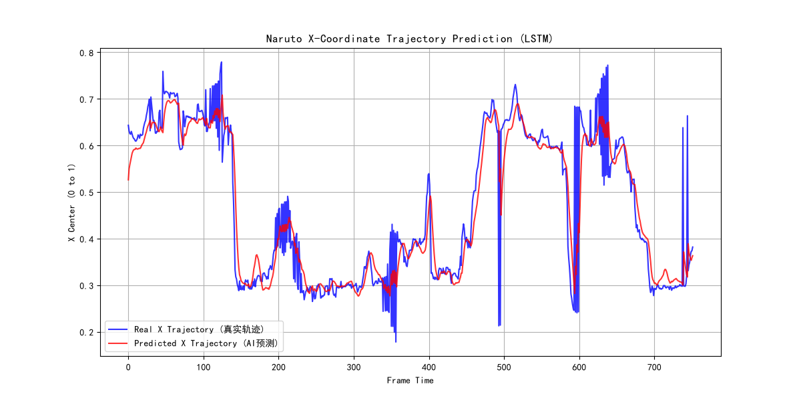

# 忍者预测 (ShinobiPredict) - 火影忍者格斗数据采集与轨迹预测

这是一个基于计算机视觉（YOLOv5）与时序神经网络（LSTM）的对战视频分析项目。本项目旨在通过解析格斗游戏视频，提取角色的实时坐标，并利用深度学习模型预测角色的下一步走位，为后续的动作识别与博弈分析打下基础。

## 🚀 项目已实现功能 (Current Progress)

1. **视频自动拆帧 (Data Extraction)**：通过 OpenCV 智能提取视频帧，并支持拖拽式批处理。
2. **目标检测 (Object Detection)**：利用 YOLOv5 训练了专属的“鸣人”检测模型，mAP@0.5 达到 0.9 以上。
3. **数据清洗与结构化 (Data Processing)**：将 YOLO 输出的散装 txt 坐标日志，按时间序列清洗并转化为标准的 Excel/CSV 格式。
4. **走位轨迹预测 (Trajectory Prediction)**：构建 LSTM 神经网络，通过前 10 帧的坐标序列，精准预测下一帧的角色落点。

## 📊 模型效果展示

以下是 LSTM 模型预测的走位轨迹（红线为 AI 预测，蓝线为真实走位），可见模型极其精准地捕捉了角色的移动趋势，并有效过滤了游戏画面的抖动噪音：



## 🛠️ 环境配置 (Setup)

1. 克隆本仓库（注：数据集与模型权重过大，未上传至仓库，需自行训练）。
2. 安装依赖：
   ```bash
   pip install -r requirements.txt